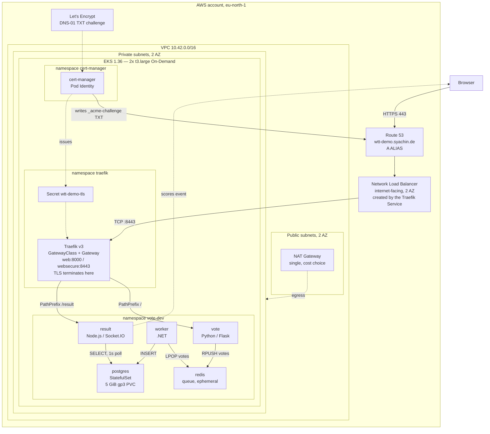

# wtt-demo — Platform Engineering Demonstration

A small voting application deployed on AWS EKS, built to demonstrate platform engineering practice: infrastructure as code, Kubernetes operations, ingress and TLS, identity, persistence, and the engineering process around them.

**Independent portfolio project.** Prepared by Alexander Syachin for a Platform & Systems Engineer interview with WTT CampusONE on 16 October 2026. This is not an official WTT CampusONE product, service, or infrastructure.

## Live demonstration

| Endpoint | Purpose |
|---|---|
| https://wtt-demo.syachin.de/ | Voting page |
| https://wtt-demo.syachin.de/result/ | Live results, updated over Socket.IO |

Public HTTPS with a Let's Encrypt production certificate. The trailing slash on `/result/` matters; `/result` redirects to it.

## What this demonstrates

The application is deliberately small and is not the point. The engineering work around it is:

- Reproducible AWS infrastructure in Terraform, split into four state-isolated roots.
- An EKS cluster with worker nodes in private subnets and a public load balancer.
- Workload identity through EKS Pod Identity, with no static AWS credentials anywhere.
- Ingress through the Kubernetes Gateway API rather than vendor annotations.
- Automated TLS with cert-manager and a Route 53 DNS-01 solver scoped to a single record name.
- Stateful workload on an EBS-backed volume.
- A delivery process with per-block acceptance criteria, recorded evidence, and honest status.

## Architecture

Full detail, including the identity model and the TLS path: [docs/architecture.md](docs/architecture.md).

## Components

| Layer | Technology | Responsibility |
|---|---|---|
| Infrastructure as code | Terraform 1.16, AWS provider 6.68.0 | VPC, NAT, IAM, EKS, add-ons. Four roots with S3 remote state and native S3 locking. |
| Orchestration | Amazon EKS 1.36 | Two `t3.large` On-Demand nodes in private subnets, two availability zones |
| Identity | EKS Pod Identity | Scoped IAM for the EBS CSI driver and cert-manager. No static keys. |
| Ingress | Kubernetes Gateway API, Traefik v3 | `GatewayClass`, one `Gateway`, three `HTTPRoute` objects. TLS terminates at Traefik. |
| Load balancing | AWS Network Load Balancer | Created by the Traefik `Service`, layer 4, internet-facing |
| DNS and TLS | Route 53, cert-manager, Let's Encrypt | Production certificate via DNS-01, least-privilege solver |
| Storage | EBS CSI driver, `gp3` StorageClass | Encrypted 5 GiB PVC for PostgreSQL |
| Application | Flask, Redis, .NET, PostgreSQL 17, Node.js 22 | Vote → queue → worker → database → live results |
| Images | GitHub Container Registry | Tagged with the source commit, built manually today |

## Status

One application environment is deployed: **`vote-dev`**, which serves the public demonstration. There is no production environment. The `vote-prod` namespace exists and is empty.

| Capability | State |
|---|---|
| Terraform infrastructure, EKS, networking, IAM | Implemented |
| Five application workloads running | Implemented |
| PostgreSQL persistence across pod restart | Implemented, operator-verified |
| Gateway API routing, including Socket.IO and the `/result/` redirect | Implemented, externally verified |
| Public HTTPS with a trusted production certificate | Implemented, externally verified |
| Mixed-content defect on the vote page | Source fixed and deployed; browser confirmation outstanding |
| HTTP-to-HTTPS redirect | **Not implemented.** Port 80 currently serves plaintext. |
| Browser security headers | **Not implemented** |
| GitOps delivery with Argo CD | Planned, Block 05 |
| PostgreSQL backup and restore | **Not implemented.** See the data-loss risk in [docs/blocks/06-data-durability.md](docs/blocks/06-data-durability.md). |
| CI pipeline | **Not implemented.** Images are built by hand. |
| Observability, Prometheus and Grafana | Not implemented, optional |
| Security hardening: non-root, Pod Security, NetworkPolicy | Not implemented, optional |

This system is a demonstration. It is not production-ready, and the gaps above are the reason.

Delivery blocks, acceptance criteria and evidence: [docs/roadmap.md](docs/roadmap.md).

## Architectural rationale

The decisions that shaped the platform, with the trade-off each one accepted:

| Decision | Reason |
|---|---|
| Data services in the cluster, not RDS or ElastiCache | Keeps the StatefulSet, PVC and recovery work inside the project rather than delegating it to AWS. Accepted cost: single-pod PostgreSQL, no automated backup yet. |
| Gateway API with Traefik, not an ALB with Ingress | Standard, portable routing objects, and routing that can be tested without AWS. Accepted cost: Traefik is a component to run, and TLS becomes the project's responsibility. |
| cert-manager with DNS-01, not ACM | An ACM certificate cannot be exported, so Traefik cannot use one. DNS-01 also issues before any public traffic exists. Accepted cost: renewal is now an operational duty. |
| EKS Pod Identity, not IRSA or access keys | Simpler trust policy, no OIDC provider to manage, no credential to leak. |
| Four Terraform roots, not one | Blast-radius isolation: a mistake in the EKS root cannot destroy the network state. Accepted cost: cross-root wiring and a required apply order. |
| Private nodes with a public load balancer | Nothing in the cluster is directly reachable from the internet. Egress is through one NAT Gateway, a deliberate cost choice over per-zone redundancy. |
| Two `t3.large` nodes | Sized for pod density, not CPU. The AWS VPC CNI limits pods per node by ENI capacity. See [docs/lessons.md](docs/lessons.md). |

Original decision records, current applicability, and the four retrospective records: [docs/decisions/README.md](docs/decisions/README.md).

## Cost

Roughly **250 to 290 USD per month**, about **0.35 USD per hour**, dominated by the EKS control plane, two On-Demand nodes and the NAT Gateway. These are list-price estimates, not billing data. Breakdown and reduction options: [docs/architecture.md](docs/architecture.md#cost-estimate).

Teardown procedure, with the ordering traps that otherwise leave resources billing: [docs/operations/teardown.md](docs/operations/teardown.md).

## Documentation

| Topic | Document |
|---|---|
| Documentation index | [docs/README.md](docs/README.md) |
| Implemented architecture | [docs/architecture.md](docs/architecture.md) |
| Application workloads and defect register | [docs/application.md](docs/application.md) |
| Delivery roadmap and block status | [docs/roadmap.md](docs/roadmap.md) |
| Plan versus implementation, every deviation | [docs/reconciliation.md](docs/reconciliation.md) |
| Rebuild from a clean environment | [docs/operations/reproduce.md](docs/operations/reproduce.md) |
| Verify every layer | [docs/operations/verify.md](docs/operations/verify.md) |
| Troubleshooting | [docs/operations/troubleshoot.md](docs/operations/troubleshoot.md) |
| Teardown and cost control | [docs/operations/teardown.md](docs/operations/teardown.md) |
| Operational lessons from the build | [docs/lessons.md](docs/lessons.md) |
| Decisions | [docs/decisions/README.md](docs/decisions/README.md) |
| Delivery process and change control | [docs/process.md](docs/process.md) |

---

**Author:** [Alexander Syachin](https://github.com/asyachin) · **Repository:** `asyachin/wtt-demo` · **Region:** `eu-north-1`
